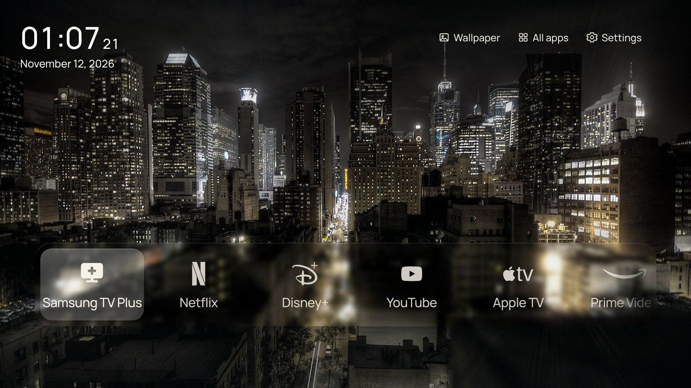

# CleanFrame for any Samsung TV

A quieter home screen for Samsung Tizen TVs: your apps, a photograph, the time and date, with an interface made for the remote. This is a community fork of [nthnclrk/CleanFrame](https://github.com/nthnclrk/CleanFrame), adapted for **non‑Frame** Samsung TVs and extended with a slideshow manager, a card‑grid app editor, and a long‑press app menu.



I run this on a 2024 Crystal UHD (`UN75DU7200FXZA`, Tizen 9). The original was built for a Samsung The Frame; all credit for the launcher goes to the upstream author. I'm sharing this variant as a starting point for other non‑Frame TVs, not as a finished product.

**Use it at your own risk.** Installing the launcher works broadly (Tizen 5.0+), but no device flow is guaranteed on every model. Art Mode features are Frame‑only. The optional native‑Home change uses undocumented, model‑ and firmware‑specific settings and can fail after updates — adapt it and keep a recovery baseline per TV.

## What this fork adds

- **Slideshow manager** — create named slideshows, pick wallpapers as selectable cards, set a custom transition speed, and play/stop from the Wallpaper menu.
- **Apps on Home** redesigned as a **card grid** (was a text list), with a direct lift‑and‑move reorder.
- **Long‑press any app** (hold OK) for a menu: Open, **Move** (in‑place — shuffle along the Home row, or rearrange the All‑apps grid), Add/Remove from Home, **Hide/Unhide**, **App info**, and an **Uninstall** helper.
- **Press Down** from the Home row to open **All apps** (Apple‑TV‑style focus grid).
- **Hidden‑apps** review list in Settings; **custom All‑apps ordering** that persists.
- Native app icons shown everywhere, **auto‑blended to monochrome only on the Home row** so the home screen stays consistent while browsing shows real icons.
- **Clock**: white, repositioned, **24‑hour**, with seconds and the **date** beneath. Reduced glass blur behind Home apps.

See [CHANGES.md](CHANGES.md) for the full list.

## Try the interface

You need Node.js 22.13+ (or 24+) and Python 3.10+ for the browser preview — no TV required.

```sh
git clone https://github.com/MrMerlin1/CleanFrame.git
cd CleanFrame
npm ci
npm run dev:public
```

Open [localhost:4795/home/](http://localhost:4795/home/). Use the arrow keys, Enter and Escape, or click. **Hold Enter** on an app for the long‑press menu. App launches and Samsung‑only screens need a real TV; the preview says so when you select them.

## Using the launcher

| Area | What it does |
| --- | --- |
| Remote | Arrows navigate; OK selects; Back goes up a level. **Hold OK** on an app for its menu. **Down** from the Home row opens All apps. |
| Wallpaper | Pick a background and open **Slideshows** to build/play a named slideshow at a custom speed. |
| Apps on Home | A card grid; long‑press → Move to reorder in place, or Add/Remove from Home. |
| All apps | Every installed app; long‑press → Move to set a custom order, Hide to declutter. |
| Settings | Background, layout, typography, focus/glass material, **Hidden apps**, and Samsung Home/TV settings and HDMI inputs. |

Your preferences, slideshows, custom order and hidden/blended choices are saved on the TV.

## Put it on a TV

Follow the staged [setup guide](docs/agent-tv-setup-guide.md): Developer Mode on the remote, official Samsung tools, **your own** certificate and app identity in `.local/signing.json` (based on `signing.example.json`), build, sign, install, then the optional Home‑button change with a saved recovery baseline. Installing the app and assigning the Home button are separate steps, and **nothing in this repo contains signing keys or device IDs** — you supply your own.

| Area | Evidence and limits |
| --- | --- |
| This fork's TV | Samsung `UN75DU7200FXZA` (2024 Crystal UHD), Tizen 9, 32‑bit ARM. Install, launch, navigation and the native Home‑button takeover confirmed. |
| Upstream reference | Samsung The Frame `QA55LS03DAWXXY`, firmware 2130.0, Tizen 9 — see the upstream [device reports](docs/compatibility.md). |
| Non‑Frame caveats | Art Mode is Frame‑only. Native‑Home settings are model/firmware‑specific; the upstream guard refuses other targets, so the helper needs per‑TV adaptation and an exact‑value recovery baseline. |
| Other platforms | Android TV, Google TV, LG webOS and Roku need separate implementations. |

## Develop and check

```sh
npm run check
CLEANFRAME_PUBLIC_FONTS=1 npm run check:browser
npm run check:public
```

The source and browser checks never contact a TV. See [development](docs/development.md) and [testing](docs/testing.md).

| Location | Purpose |
| --- | --- |
| `app/` | Packaged UI and runtime assets |
| `scripts/` | Preview, validation, asset generation and reference TV tools |
| `app/assets/wallpapers/catalog.local.js` | **Git‑ignored** — your own wallpapers load from here, kept out of the public repo |
| `.local/`, `dist/` | Ignored private setup, certificates, recovery data and generated packages |

## Add your own wallpapers

Drop images in `app/assets/wallpapers/` and register them in a git‑ignored `app/assets/wallpapers/catalog.local.js` (loaded automatically after the public catalog). Your personal collection stays local and is never committed.

## Contribute

Fork it, experiment, and adapt it to your TV. Reports are most useful with model, firmware and the observed result, with private identifiers removed. Read [CONTRIBUTING.md](CONTRIBUTING.md) before a larger change.

## Licence and credits

Original code and documentation by [nthnclrk/CleanFrame](https://github.com/nthnclrk/CleanFrame) under the [MIT licence](LICENSE); this fork keeps it. Fonts, photographs and logos retain their own terms — see [THIRD_PARTY_NOTICES.md](THIRD_PARTY_NOTICES.md). Extra city/wildlife wallpapers come from **Wikimedia Commons** under CC‑BY / CC‑BY‑SA / CC0 and are credited in [ADDED-CREDITS.md](app/assets/wallpapers/ADDED-CREDITS.md). CleanFrame is an independent project with no Samsung or streaming‑service affiliation.
